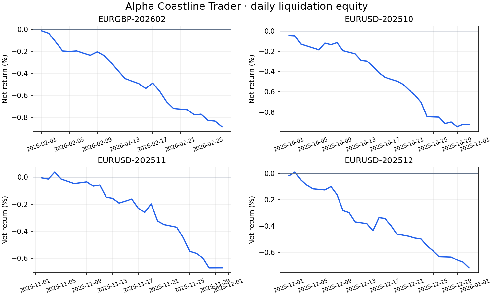

# Alpha Coastline Trader

Directional-change FX strategies with overshoot entries, inventory-aware exits, and four-scale capital allocation. Refactored from a research notebook into a tested Python package.

## Run

```bash
python -m venv .venv
source .venv/bin/activate
python -m pip install --upgrade pip
python -m pip install -e '.[test]'
pytest -q
dc-fx --demo
```

For a local HistData tick file:

```bash
dc-fx --input data/ticks.csv --one-way-cost 0.00002 --output output
```

Outputs: trade ledger, daily liquidation equity, and JSON metrics. Use `--strategy coastline` or `--strategy alpha` for single-scale variants; the default is the inventory-aware four-scale engine.

## Project

| Path | Purpose |
| --- | --- |
| `src/dc_fx/data.py` | Tick validation and synthetic demo |
| `src/dc_fx/directional_change.py` | Online event detection |
| `src/dc_fx/backtest.py` | Strategy, inventory rules, account ledger, scale allocation |
| `src/dc_fx/metrics.py` | Daily returns, drawdown, descriptive Sharpe |
| `src/dc_fx/research.py` | Scaling diagnostics and baseline sensitivity |
| `src/dc_fx/cli.py` | Command-line runner |
| `tests/` | Accounting, causality, data and edge-case checks |
| `scripts/validate_local_data.py` | Four-dataset replay |
| `results/` | Aggregate validation and daily equity |



See [corrections](docs/corrections.md), [methodology](docs/methodology.md), and [results](docs/results.md).

The four historical samples lose money after assumed costs. This is a research backtester with same-tick mid-price fills and fixed costs; it is not connected to a broker. Vendor tick files and the original coursework notebook are not distributed.
